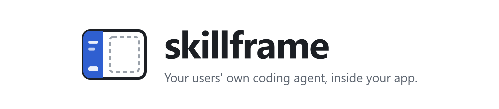
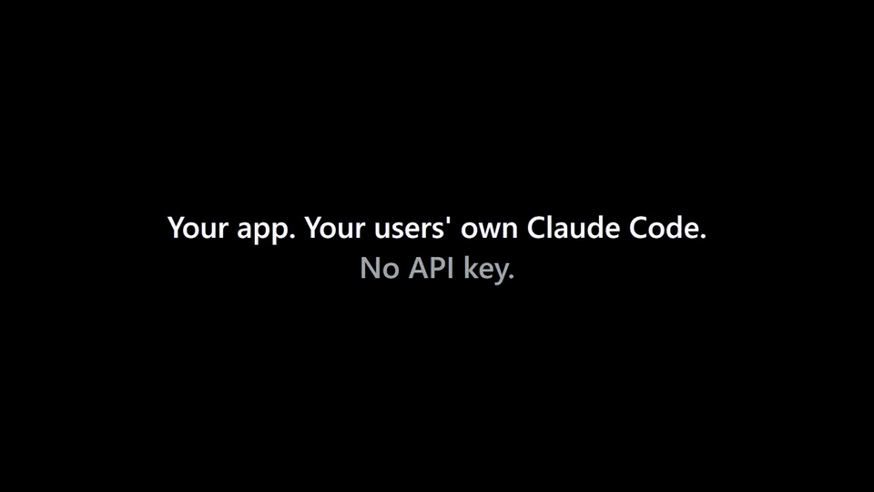

<p align="center">
  <picture>
    <source media="(prefers-color-scheme: dark)" srcset="https://raw.githubusercontent.com/RuiquanQiao/skillframe/main/docs/media/banner-dark.png">
    
  </picture>
</p>

<p align="center">
  <a href="https://github.com/RuiquanQiao/skillframe/actions/workflows/ci.yml"></a>
  <a href="https://www.npmjs.com/package/skillframe"></a>
  <a href="LICENSE"></a>
  
  
  
</p>

<p align="center">
  <a href="#quick-start">Quick start</a> ·
  <a href="#use-it-in-your-app">Use it in your app</a> ·
  <a href="#how-it-works">How it works</a> ·
  <a href="docs/PROTOCOL.md">Protocol</a> ·
  <a href="#how-it-compares">How it compares</a> ·
  <a href="#faq">FAQ</a> ·
  <a href="README.zh-CN.md">简体中文</a>
</p>

skillframe gives your app a sidebar that runs **your users' own coding agent**: Claude Code, Codex,
or any agent that speaks the [Agent Client Protocol](https://agentclientprotocol.com) (such as Qwen
Code). It runs on **their** subscription, and it is wired both ways into your UI.

No API key and no token bill for you: an AI sidebar for Electron, Tauri and local web apps that
uses your users' Claude Code or Codex subscription. Not sure how that differs from an agent SDK?
See [How it compares](#how-it-compares).

<p align="center">
  
  <br>
  <sub>Recorded with the real Claude Code and Codex; waits for the agent are sped up. <a href="https://github.com/RuiquanQiao/skillframe/raw/main/docs/media/skillframe-demo.mp4">Full-quality MP4</a></sub>
</p>

## Why skillframe

- **No API keys, no usage bill.** Your users don't paste a key and you don't pay for their tokens:
  the sidebar runs the agent they already installed and signed in to.
- **Two-way.** The agent calls your app's functions as tools, edits files your page is watching,
  and is told what the user is looking at. Your buttons can start a task in the sidebar.
- **Any agent.** Claude Code, Codex and ACP agents behind one sidebar. Users pick; you don't bet
  your product on one vendor.
- **Drop-in, or yours to change.** One Web Component and one Node function. No runtime
  dependencies, any front-end framework or none, and it runs in Electron or Tauri too. Want to
  change the core or the sidebar itself? `npx skillframe eject` copies them into your app
  ([Make it yours](#make-it-yours)).
- **The rest of the window is yours.** skillframe is only the sidebar. What goes next to it (an
  editor, a canvas, a dashboard, a game) is up to you.

Why not a plugin inside Claude Code instead? Claude Code and Codex can't show your app inside their
own windows: Claude Code's mods draw fixed components (no HTML), and MCP Apps (HTML in the chat)
aren't drawn in Claude Code. skillframe turns it around and puts the agent inside your app.

## Quick start

```bash
npm create skillframe my-app
cd my-app
npm install
npm start
```

Open the address it prints: a todo list on the right, the agent on the left. Ask it to "add a todo
to buy milk".

You need Node 22 or later and at least one of these agents installed and signed in:

| Agent | Install | Sign in | Tested with the real agent |
|---|---|---|---|
| Claude Code | `npm install -g @anthropic-ai/claude-code` | run `claude`, then `/login` | yes |
| Codex | `npm install -g @openai/codex` | `codex login` | yes |
| Qwen Code (ACP) | `npm install -g @qwen-code/qwen-code` | run `qwen`, then `/auth` | connection only |

## Use it in your app

### Server (Node 22+)

```js
import { appDataDir, createSkillframe } from "skillframe";

const home = appDataDir("my-app"); // %APPDATA%\my-app, ~/Library/Application Support/my-app, ~/.local/share/my-app

const sf = createSkillframe({
  appName: "My App",
  workspace: `${home}/workspace`, // the agent's working folder
  dataDir: `${home}/app`,         // chats, attachments, history
  static: "./public",             // your page, served at /
  watch: ["todos.json"],          // files you and the agent both edit
  context: ({ screen }) => `The user has todo #${screen?.selected} open.`,
  tools: {
    add_todo: {
      description: "Add a todo to the user's list.",
      input: { text: "string" },
      run: ({ text }, { chatId }) => {
        const { text: raw, hash } = sf.files.read("todos.json");
        // on top of the version just read: throws Conflict if the agent changed the file meanwhile
        sf.files.write("todos.json", addTodo(raw, text), { baseHash: hash });
        return "Added.";
      },
    },
  },
});

await sf.listen({ port: 4320 });
```

> [!TIP]
> A `workspace` outside your app's source repository is usually what you want: Claude Code keeps
> its memory per git repository, so an agent working inside your repo shares memory with whoever
> develops it. skillframe doesn't enforce this; any folder works.

### Page (any framework, or none)

```html
<script type="module" src="/sf/ui/skillframe-chat.js"></script>
<skillframe-chat endpoint="/sf"></skillframe-chat>

<script type="module">
  const chat = document.querySelector("skillframe-chat");
  chat.setScreen({ selected: 3 });                                        // sent with every message
  chat.addEventListener("file-changed", (e) => reload(e.detail.path));    // the agent edited a watched file
  chat.addEventListener("sf:todos", (e) => draw(e.detail));               // your sf.publish("todos", …)
  button.onclick = () => chat.ask({ prompt: "Tidy up my todos", shown: "Tidy up" });
</script>
```

Your page reads and writes the shared files too: `GET /sf/files?path=todos.json` gives
`{ text, hash }`; `POST /sf/files` with `{ path, text, baseHash }` answers 409 with the newer
version instead of overwriting the agent's edit.

### Already have a server, or a desktop shell

```js
http.createServer(async (req, res) => {
  if (await sf.handler(req, res)) return;
  // …your routes
}).listen(3000, "127.0.0.1");
sf.setOrigin("http://127.0.0.1:3000");
```

In Electron, start skillframe in the main process and load its URL in the window:
[examples/electron](examples/electron). Tauri and plain browser windows work the same way.

<details>
<summary><b>All server options and methods</b></summary>

| Option | |
|---|---|
| `appName` | told to the agent; also names the tools' MCP server |
| `workspace` | the agent's working folder (its own CLAUDE.md, AGENTS.md, skills and settings load as usual) |
| `dataDir` | where chats, attachments and file history go |
| `agents` | which agents to offer, first is the default (default: every agent skillframe knows; missing ones show as not installed) |
| `context({ chatId, screen })` | what the user is looking at, in words; added to the agent's instructions with every message |
| `tools` | your app's abilities: `{ description, input, optional?, run(args, { chatId }) }`. `input` is JSON Schema properties or the shorthand `{ name: "string" }`. Offered to the agent over MCP and pre-approved. A thrown error goes back to the agent as a failed tool result. |
| `watch` | globs of shared files in `workspace` (`"todos.json"`, `"data/**/*.md"`) |
| `static` | a folder `listen()` serves at `/` |
| `basePath` | where the sidebar's routes live (default `/sf`) |
| `allowedTools` | more Claude Code permission rules that never ask (`"Bash(git status*)"`) |
| `allowedHosts` | Host names accepted besides the loopback ones |
| `env` | environment for the agent processes |

| On `sf` | |
|---|---|
| `listen({ port, host, routes })` | starts a local server; `routes(req, res)` answers your own requests first (return `true` when it did) |
| `handler(req, res)` | to mount skillframe in your own server; resolves `true` when it answered |
| `setOrigin(url)` | with `handler`: the address agents reach your tools at |
| `files.read(path)` / `files.write(path, text, { baseHash })` | the shared files, with versions (`hash`); a stale `baseHash` throws `Conflict` |
| `publish(name, data)` | an event of your own to every open page (the element fires `sf:<name>`) |
| `send(chatId, { text, shown, screen, files })` | start a reply from the server |
| `on((event, data) => …)` | every event, in process |
| `close()` | stop agents, watchers and servers |

</details>

<details>
<summary><b>All page attributes, methods and events</b></summary>

| | |
|---|---|
| attributes | `endpoint` (default `/sf`), `lang` (`en`, `zh`; default the browser's), `theme` (`light`, `dark`; default the system's) |
| `setScreen(obj)` | what the user is looking at; your `context()` receives it |
| `ask({ prompt, shown })` | start a reply from your own button; resolves `{ ok, error }` when it ends. `shown` is what the transcript displays. |
| `newChat()` | |
| events | `chat-done` (`{ ok, error, cancelled }`), `file-changed` (`{ path, hash, by }`), `sf:<name>` |
| CSS variables | `--sf-ink`, `--sf-muted`, `--sf-line`, `--sf-soft`, `--sf-accent`, `--sf-attention`, `--sf-danger`, `--sf-bg` |

</details>

## Make it yours

skillframe is MIT and meant to be changed. Use it either way:

- **As a dependency** (`import from "skillframe"`): you get fixes with `npm update`, and you shape
  it through the options, tools, events and CSS variables above.
- **As your own code**: copy it into your app and change anything, the sidebar's look, the routes,
  how an agent is started. You stop getting updates from npm; the
  [changelog](CHANGELOG.md) says what changed upstream.

```bash
npx skillframe eject                     # in an app that has skillframe: copies it to ./skillframe
npm create skillframe my-app -- --eject  # a new app with skillframe already copied in
```

Then import it by path: `import { createSkillframe } from "./skillframe/index.js"`. The copy is the
plain JavaScript npm ships (no build step); the TypeScript it comes from is in
[packages/skillframe/src](packages/skillframe/src).

| File in the copy | What it does |
|---|---|
| `ui/skillframe-chat.js` | the whole sidebar: one Web Component, styles in its shadow root |
| `core/index.js` | `createSkillframe()` and its options |
| `core/http.js` | the routes the sidebar calls, and the local-only checks |
| `core/chat/runner.js`, `core/chat/store.js` | running replies; saving chats |
| `core/drivers/claude.js`, `codex.js`, `acp.js`; `core/agents.js` | how each agent is started and spoken to; the list of agents |
| `core/mcp.js` | your `tools`, served to the agent over MCP |
| `core/files.js` | watched shared files and conflict detection |

The copy's own README has the full list. Keep `ui/` and `bin/` next to `core/`: the core finds them
by looking upward from its own folder.

## What the sidebar does

- Streams replies, thinking and tool steps; shows the agent's task list.
- Cards for the agent's permission requests, its questions and its plans: allow, always allow, or
  deny with a reason; pick answers; approve a plan or keep planning.
- Pickers for the agent, the permission mode and the model; a stop button; messages typed while
  the agent works wait in a queue.
- Attachments: paste, drop or pick files. Images go to the agent as images, other files by path.
- Fork a chat from any reply (Claude Code and Codex).
- Light and dark, English and Chinese, from 320 px wide up. Its styles live in a shadow root, so
  they can't clash with yours; its colors are CSS variables you can set.

## How it works

```
┌──────────────────────────┬──────────────────────────────────────┐
│ <skillframe-chat>        │  your app (any HTML)                 │
│  the user's own agent    │                                      │
│                          │   ◀── the agent calls your tools      │
│  "add a todo: buy milk"  │   ◀── it edits a file you watch       │
│                          │   ──▶ you tell it what's on screen    │
└──────────────────────────┴──────────────────────────────────────┘
```

The core starts each agent the way its own SDK or editor integration does: Claude Code with
`claude -p` and stream-json, Codex with `codex app-server`, ACP agents over the Agent Client Protocol.
Your tools reach every agent as one local MCP server that only processes skillframe started can call.
The page talks to the core over HTTP and server-sent events. [docs/PROTOCOL.md](docs/PROTOCOL.md)
describes it, so a backend in another language can drive the same sidebar.

The local server answers only its own page: it accepts loopback Host names only, same-origin JSON
requests only, and a token for the tools.

## How it compares

skillframe makes no model calls of its own. It starts the coding agent the user already installed
and signed in to, and gives your app a ready-made sidebar for it. The projects below solve nearby
problems; each row says what that project does and what skillframe does on top. (Checked against
each project's own docs on 2026-11-02.)

| Project | What it does | What skillframe does differently |
|---|---|---|
| [Claude Agent SDK](https://code.claude.com/docs/en/agent-sdk/overview) (`@anthropic-ai/claude-agent-sdk`) | A Python and TypeScript library that runs Claude Code's agent loop inside your own process. Anthropic's docs say products built on it should use API key authentication and may not offer claude.ai login to their users without Anthropic's approval. No UI. | Starts the user's own, unmodified `claude` command on the user's own sign-in (see the [FAQ](#faq)), and also Codex and ACP agents. Comes with the sidebar: replies, permission, question and plan cards, agent and model pickers. |
| [Vercel AI SDK](https://ai-sdk.dev) (`ai`) | A TypeScript toolkit for calling model APIs, with chat UI hooks such as `useChat`. Its official providers authenticate with your API key (the Anthropic provider reads `ANTHROPIC_API_KEY`). You write the agent's tools and the chat UI. | No model API and no key: the agent in the sidebar is a full coding agent that already reads files, runs commands and loads its own skills. Your app adds its functions as tools; the sidebar UI is built. |
| [Claude Code Router](https://github.com/musistudio/claude-code-router) (`@musistudio/claude-code-router`) | A local model gateway: it sends Claude Code's model requests to other providers (OpenRouter, DeepSeek, Moonshot and more) with API keys you enter. It has its own desktop app and a web management UI, not a component to embed. | A different layer. Claude Code Router changes where the agent's model calls go; skillframe puts the agent into your app's window and wires it to your UI. |
| [cligent](https://github.com/sublang-dev/cligent) (`@sublang/cligent`) | One TypeScript SDK and event stream for several coding agent CLIs: Claude Code (through the Claude Agent SDK), Codex, Gemini CLI, Kimi Code, OpenCode. It uses each CLI's own sign-in or API key. The library has no UI. | Ships the UI, serves your app's tools to every agent over one MCP server, shares watched files with conflict detection, and tells the agent what's on screen. cligent supports more agents today. |

## FAQ

<details>
<summary><b>Is it allowed to run my users' Claude Code subscription like this?</b></summary>

skillframe only starts the agent command the user installed and signed in to themselves,
**unmodified**. It never ships its own copy of an agent, never uses the Claude Agent SDK, and never
reads, stores or forwards a sign-in; sign-in always happens in the agent's own flow. Anthropic's
[Legal and compliance](https://code.claude.com/docs/en/legal-and-compliance) page says developers
building products should use API keys, and also that this does not prevent an end user from signing
in to the unmodified Claude Code binary with their own subscription. That page has changed several
times in 2026: if you ship a commercial product, read it yourself. Supporting several agents from
day one is skillframe's answer to that risk.

</details>

<details>
<summary><b>Who pays for the tokens?</b></summary>

The user, through the plan they already have with Claude, ChatGPT or another provider. Your app
never sees a key and never makes a model call of its own.

</details>

<details>
<summary><b>Can I deploy it as a website that anyone opens in a browser?</b></summary>

No. skillframe starts the agent on the computer that runs your app's server, so that server has
to be the user's own computer: a local web app the user starts, or a desktop app (Electron,
Tauri). On a hosted server the agent would run on your machine, with your sign-in, for every
visitor. By default skillframe only listens on 127.0.0.1 and only accepts requests addressed to
`localhost`, `127.0.0.1` or `[::1]`, so another computer can't reach it.

</details>

<details>
<summary><b>What if the user has no agent installed?</b></summary>

The sidebar says which agents are missing or signed out, with the command to install each one and
how to sign in. Agents that aren't installed show as "not installed" in the picker.

</details>

<details>
<summary><b>Can the agent touch files outside my app?</b></summary>

It works in the `workspace` folder you give it, with the permission mode the user picks: "ask
before edits" asks before every edit or command, and the sidebar shows each request as a card. Your
own tools are pre-approved; anything else follows the agent's own permission rules.

</details>

<details>
<summary><b>My backend isn't Node. Can I still use it?</b></summary>

The sidebar only talks HTTP and server-sent events, described in [docs/PROTOCOL.md](docs/PROTOCOL.md).
Today the core that speaks to the agents is the Node package; a backend in another language can
run it as a small sidecar process, or reimplement the protocol.

</details>

## Docs

| Goal | Start here |
|---|---|
| Run the example | [Quick start](#quick-start) |
| Add the sidebar to an app you have | [Use it in your app](#use-it-in-your-app) |
| Put it in a desktop app | [examples/electron](examples/electron) |
| Change the core or the sidebar itself | [Make it yours](#make-it-yours) |
| Drive the sidebar from another language | [docs/PROTOCOL.md](docs/PROTOCOL.md) |
| Read the decisions behind it | [docs/DESIGN.md](docs/DESIGN.md) (Chinese) |
| Re-record the demo | [docs/DEMO.md](docs/DEMO.md) (Chinese) |

## Develop

```bash
npm install
npm test
```

Every test runs against a fake Claude Code, a fake Codex and a fake ACP agent that speak the same
protocols as the real ones, so the tests cost no tokens. The sidebar tests drive the Chrome or Edge
already on the machine, headless; without either they are skipped and say so. CI runs them on
Windows, macOS and Linux, on Node 22 and 24.

- `packages/skillframe`: the library (no runtime dependencies)
- `packages/create-skillframe`: `npm create skillframe`
- `examples/hello`: notes, with TypeScript (`npm run hello`)
- `examples/grill-me`: a popular terminal-only skill (Matt Pocock's `grilling`) given a screen: the
  agent puts each round of questions in a form and the decisions grow into a tree (`npm run grill`)
- `examples/blank`: only the sidebar, next to an empty main area, for trying skillframe itself
  (`npm run blank`)
- `examples/studio`: build an app inside skillframe. Open a project folder; the agent works in it
  and the project's page runs beside the chat, reloading when a file changes and passing its
  errors to the agent (`npm run studio -- <folder>`)
- `examples/electron`: the same sidebar in an Electron window (`cd examples/electron && npm install && npm start`)

On Windows, `npm run exe` makes `skillframe.exe`, `skillframe Studio.exe`, `Grill Me.exe` and
`Hello Notes.exe` in the repository folder. Each opens its example in a window of its own, without a terminal, and stops it
when the window closes. They need Node.js and `npm install`, and stay in the repository folder.

## Roadmap

- [x] Claude Code, Codex and ACP drivers; tools over MCP; shared files with conflict detection
- [x] Permission, question and plan cards; mode and model pickers; attachments; forks
- [x] `npm create skillframe`, an Electron example, CI on three systems
- [x] First release on npm ([changelog](CHANGELOG.md))
- [ ] Full chat verified with a real ACP agent (Qwen Code)
- [ ] More agents, such as Pi

Issues and pull requests are welcome.

## License

[MIT](LICENSE)
