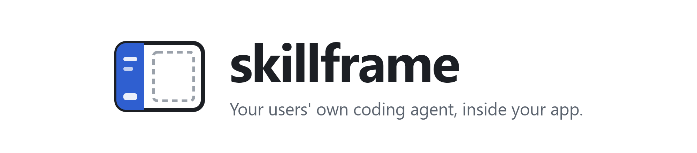
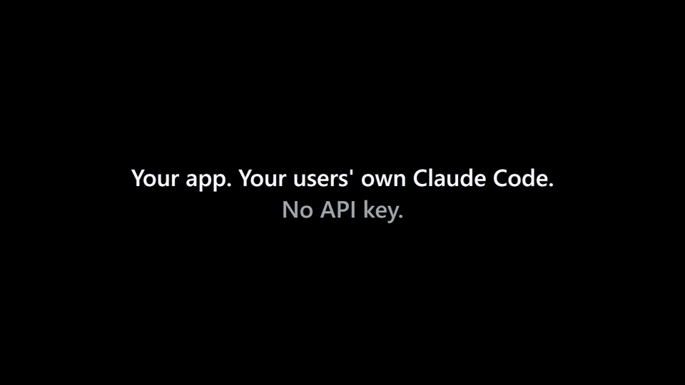

<p align="center">
  <picture>
    <source media="(prefers-color-scheme: dark)" srcset="https://raw.githubusercontent.com/RuiquanQiao/skillframe/main/docs/media/banner-dark.png">
    
  </picture>
</p>

<p align="center">
  <a href="https://github.com/RuiquanQiao/skillframe/actions/workflows/ci.yml"></a>
  <a href="https://www.npmjs.com/package/skillframe"></a>
  <a href="LICENSE"></a>
  
  
  
</p>

<p align="center">
  <a href="#快速开始">快速开始</a> ·
  <a href="#接进你的-app">接进你的 app</a> ·
  <a href="#原理">原理</a> ·
  <a href="docs/PROTOCOL.md">协议</a> ·
  <a href="#和类似项目的区别">和类似项目的区别</a> ·
  <a href="#常见问题">常见问题</a> ·
  <a href="README.md">English</a>
</p>

skillframe 给你的 app 加一个侧边栏，里面跑的是**用户自己的 coding agent**：Claude Code、Codex，
或者任何支持 [Agent Client Protocol](https://agentclientprotocol.com)（ACP）的 agent，比如 Qwen Code。
用的是**用户自己的**订阅额度，而且和你的界面双向联动。

不用 API key，你也不用为 token 付钱：这是一个给 Electron、Tauri 和本地 web app 用的 AI 侧边栏，
跑的是用户自己的 Claude Code 或 Codex 订阅。想知道它和各种 agent SDK 有什么区别，见
[和类似项目的区别](#和类似项目的区别)。

<p align="center">
  
  <br>
  <sub>用真实的 Claude Code 和 Codex 录制，等待 agent 回复的片段加速播放。<a href="https://github.com/RuiquanQiao/skillframe/raw/main/docs/media/skillframe-demo.mp4">原画质 MP4</a></sub>
</p>

## 为什么用 skillframe

- **不用 API key，不用你付钱。** 用户不用粘贴 key，你也不用替用户的 token 买单：侧边栏跑的是用户
  已经装好、已经登录的 agent。
- **双向联动。** agent 能把你 app 里的函数当工具调用，能改你页面正在监听的文件，还知道用户此刻在看
  什么。你的按钮也能直接在侧边栏里发起任务。
- **不绑定一家。** Claude Code、Codex 和 ACP agent 共用一个侧边栏，用户自己选，你的产品不用押宝在
  一家厂商身上。
- **拿来就能用，也能拿去随便改。** 一个 Web Component 加一个 Node 函数。零运行时依赖，任何前端框架
  都行，不用框架也行，Electron、Tauri 里也能跑。想改核心或侧边栏本身？`npx skillframe eject` 会把它们
  拷进你的 app（见[改成你自己的代码](#改成你自己的代码)）。
- **窗口其余部分都是你的。** skillframe 只占侧边栏。旁边放什么（编辑器、画布、仪表盘、游戏）由你决定。

为什么不做成 Claude Code 里的插件？因为 Claude Code 和 Codex 没法在它们自己的窗口里显示你的 app：
Claude Code 的 mod 只能画固定的几种组件（不支持 HTML），MCP Apps（聊天里嵌 HTML）在 Claude Code 里
不显示。skillframe 反过来，把 agent 放进你的 app。

## 快速开始

```bash
npm create skillframe my-app
cd my-app
npm install
npm start
```

打开它打印出的地址：右边是待办列表，左边是 agent。让它"add a todo to buy milk"（加一条待办：买牛奶）。

需要 Node 22 及以上，并且电脑上至少装好、登录了下面一个 agent：

| Agent | 安装 | 登录 | 是否用真实 agent 测过 |
|---|---|---|---|
| Claude Code | `npm install -g @anthropic-ai/claude-code` | 运行 `claude`，再输入 `/login` | 是 |
| Codex | `npm install -g @openai/codex` | `codex login` | 是 |
| Qwen Code（ACP） | `npm install -g @qwen-code/qwen-code` | 运行 `qwen`，再输入 `/auth` | 只测过连接 |

## 接进你的 app

### 服务端（Node 22+）

```js
import { appDataDir, createSkillframe } from "skillframe";

const home = appDataDir("my-app"); // %APPDATA%\my-app、~/Library/Application Support/my-app、~/.local/share/my-app

const sf = createSkillframe({
  appName: "My App",
  workspace: `${home}/workspace`, // agent 的工作文件夹
  dataDir: `${home}/app`,         // 对话、附件、历史版本
  static: "./public",             // 你的页面，挂在 / 下
  watch: ["todos.json"],          // 你和 agent 都会改的文件
  context: ({ screen }) => `The user has todo #${screen?.selected} open.`,
  tools: {
    add_todo: {
      description: "Add a todo to the user's list.",
      input: { text: "string" },
      run: ({ text }, { chatId }) => {
        const { text: raw, hash } = sf.files.read("todos.json");
        // 基于刚读到的版本写入：如果 agent 在这期间改过文件，会抛出 Conflict，不会覆盖
        sf.files.write("todos.json", addTodo(raw, text), { baseHash: hash });
        return "Added.";
      },
    },
  },
});

await sf.listen({ port: 4320 });
```

> [!TIP]
> `workspace` 通常放在你 app 的源码仓库外面比较好：Claude Code 按 git 仓库保存记忆，agent 如果在你的
> 仓库里干活，会和开发这个仓库的人共用一份记忆。这只是建议，skillframe 不做限制，放哪个文件夹都能用。

### 页面（任何框架，或者不用框架）

```html
<script type="module" src="/sf/ui/skillframe-chat.js"></script>
<skillframe-chat endpoint="/sf"></skillframe-chat>

<script type="module">
  const chat = document.querySelector("skillframe-chat");
  chat.setScreen({ selected: 3 });                                        // 每条消息都会带上
  chat.addEventListener("file-changed", (e) => reload(e.detail.path));    // agent 改了被监听的文件
  chat.addEventListener("sf:todos", (e) => draw(e.detail));               // 你调用的 sf.publish("todos", …)
  button.onclick = () => chat.ask({ prompt: "Tidy up my todos", shown: "Tidy up" });
</script>
```

页面也能读写共享文件：`GET /sf/files?path=todos.json` 返回 `{ text, hash }`；`POST /sf/files` 提交
`{ path, text, baseHash }`，如果 agent 刚改过，会返回 409 和最新版本，而不是覆盖 agent 的修改。

### 已经有自己的服务器，或者是桌面应用

```js
http.createServer(async (req, res) => {
  if (await sf.handler(req, res)) return;
  // …你自己的路由
}).listen(3000, "127.0.0.1");
sf.setOrigin("http://127.0.0.1:3000");
```

Electron 里，在主进程启动 skillframe，窗口加载它的地址就行：见 [examples/electron](examples/electron)。
Tauri 和普通浏览器窗口也是同样的做法。

<details>
<summary><b>服务端的全部选项和方法</b></summary>

| 选项 | |
|---|---|
| `appName` | 告诉 agent 的 app 名字，也用作工具所在 MCP 服务器的名字 |
| `workspace` | agent 的工作文件夹（里面的 CLAUDE.md、AGENTS.md、skills 和设置照常加载） |
| `dataDir` | 对话、附件和文件历史版本存在这里 |
| `agents` | 提供哪些 agent，第一个是默认（默认是 skillframe 支持的全部；没装的显示为"未安装"） |
| `context({ chatId, screen })` | 用文字描述用户此刻在看什么；每条消息都会加进 agent 的指令里 |
| `tools` | 你 app 的能力：`{ description, input, optional?, run(args, { chatId }) }`。`input` 写 JSON Schema 的 properties，或者简写成 `{ name: "string" }`。通过 MCP 提供给 agent，并且预先批准。抛出的错误会作为工具失败的结果返回给 agent。 |
| `watch` | `workspace` 里共享文件的匹配规则（`"todos.json"`、`"data/**/*.md"`） |
| `static` | `listen()` 挂在 `/` 下的静态文件夹 |
| `basePath` | 侧边栏路由的前缀（默认 `/sf`） |
| `allowedTools` | 额外的 Claude Code 权限规则，匹配的操作不再询问（`"Bash(git status*)"`） |
| `allowedHosts` | 除本机地址外还接受的 Host 名 |
| `env` | 传给 agent 进程的环境变量 |

| `sf` 上的方法 | |
|---|---|
| `listen({ port, host, routes })` | 启动本地服务器；`routes(req, res)` 先处理你自己的请求（处理了就返回 `true`） |
| `handler(req, res)` | 把 skillframe 挂进你自己的服务器；处理了请求就 resolve `true` |
| `setOrigin(url)` | 配合 `handler` 用：agent 访问你工具的地址 |
| `files.read(path)` / `files.write(path, text, { baseHash })` | 带版本号（`hash`）的共享文件；`baseHash` 过期时抛出 `Conflict` |
| `publish(name, data)` | 给所有打开的页面发一个你自定义的事件（元素会触发 `sf:<name>`） |
| `send(chatId, { text, shown, screen, files })` | 从服务端发起一次回复 |
| `on((event, data) => …)` | 在进程内接收所有事件 |
| `close()` | 停掉 agent、文件监听和服务器 |

</details>

<details>
<summary><b>页面元素的全部属性、方法和事件</b></summary>

| | |
|---|---|
| 属性 | `endpoint`（默认 `/sf`）、`lang`（`en`、`zh`；默认跟随浏览器）、`theme`（`light`、`dark`；默认跟随系统） |
| `setScreen(obj)` | 用户此刻在看什么；你的 `context()` 会收到它 |
| `ask({ prompt, shown })` | 从你自己的按钮发起一次回复；结束时 resolve `{ ok, error }`。`shown` 是对话里显示的文字。 |
| `newChat()` | 新开一个对话 |
| 事件 | `chat-done`（`{ ok, error, cancelled }`）、`file-changed`（`{ path, hash, by }`）、`sf:<name>` |
| CSS 变量 | `--sf-ink`、`--sf-muted`、`--sf-line`、`--sf-soft`、`--sf-accent`、`--sf-attention`、`--sf-danger`、`--sf-bg` |

</details>

## 改成你自己的代码

skillframe 是 MIT 协议，本来就是让人改的。两种用法都行：

- **当依赖用**（`import from "skillframe"`）：`npm update` 就能拿到修复；通过上面的选项、工具、事件和
  CSS 变量来定制。
- **当自己的代码用**：拷进你的 app，什么都能改，侧边栏的样子、路由、agent 怎么启动都行。代价是不再从
  npm 收到更新；上游改了什么看 [CHANGELOG](CHANGELOG.md)。

```bash
npx skillframe eject                     # 已经装了 skillframe 的 app：拷到 ./skillframe
npm create skillframe my-app -- --eject  # 新建一个 app，skillframe 直接拷在里面
```

然后按路径引用：`import { createSkillframe } from "./skillframe/index.js"`。拷出来的是 npm 包里那份
纯 JavaScript，不用构建；它对应的 TypeScript 源码在 [packages/skillframe/src](packages/skillframe/src)。

| 拷出来的文件 | 管什么 |
|---|---|
| `ui/skillframe-chat.js` | 整个侧边栏：一个 Web Component，样式在它自己的 shadow root 里 |
| `core/index.js` | `createSkillframe()` 和它的选项 |
| `core/http.js` | 侧边栏调用的路由，以及只允许本机访问的检查 |
| `core/chat/runner.js`、`core/chat/store.js` | 跑回复；保存对话 |
| `core/drivers/claude.js`、`codex.js`、`acp.js`；`core/agents.js` | 每个 agent 怎么启动、怎么通信；agent 列表 |
| `core/mcp.js` | 你的 `tools`，通过 MCP 提供给 agent |
| `core/files.js` | 监听共享文件、检测冲突 |

完整列表在拷出来的那份 README 里。`ui/` 和 `bin/` 要和 `core/` 放在同一层：核心是从自己的文件夹往上找
它们的。

## 侧边栏能做什么

- 流式显示回复、思考过程和工具步骤；显示 agent 的任务列表。
- agent 请求权限、提问、提出计划时弹出卡片：允许、始终允许、带理由拒绝；选择答案；批准计划或让它继续完善。
- 可以选 agent、权限模式和模型；有停止按钮；agent 干活时发的消息会排队。
- 附件：粘贴、拖入或选择文件。图片直接给 agent 看，其他文件把路径给 agent。
- 可以从任意一条回复分叉出新对话（Claude Code 和 Codex）。
- 亮色和暗色，中文和英文，最窄 320 px。样式在 shadow root 里，不会和你的样式冲突；颜色都是 CSS 变量，可以自己改。

## 原理

```
┌──────────────────────────┬──────────────────────────────────────┐
│ <skillframe-chat>        │  your app (any HTML)                 │
│  the user's own agent    │                                      │
│                          │   ◀── the agent calls your tools      │
│  "add a todo: buy milk"  │   ◀── it edits a file you watch       │
│                          │   ──▶ you tell it what's on screen    │
└──────────────────────────┴──────────────────────────────────────┘
```

核心按每个 agent 自家 SDK 或编辑器插件的方式启动它：Claude Code 用 `claude -p` 加 stream-json，Codex
用 `codex app-server`，ACP agent 走 Agent Client Protocol。你的工具以一个本地 MCP 服务器的形式提供给
所有 agent，只有 skillframe 启动的进程能调用。页面和核心之间走 HTTP 和 server-sent events，协议写在
[docs/PROTOCOL.md](docs/PROTOCOL.md)，所以用别的语言写后端也能驱动同一个侧边栏。

本地服务器只响应自己的页面：只接受本机 Host 名、只接受同源的 JSON 请求，工具接口还要 token。

## 和类似项目的区别

skillframe 自己不调用任何模型。它启动的是用户已经装好、已经登录的 coding agent，再给你的 app
一个现成的侧边栏。下面这些项目解决的是相近的问题；每一行写清它做什么、skillframe 多做了什么。
（2026-11-02 对照各项目自己的文档核实。）

| 项目 | 它做什么 | skillframe 的不同 |
|---|---|---|
| [Claude Agent SDK](https://code.claude.com/docs/en/agent-sdk/overview)（`@anthropic-ai/claude-agent-sdk`） | Python 和 TypeScript 库，在你自己的进程里跑 Claude Code 的 agent 循环。Anthropic 文档写明：用它做的产品应当用 API key 认证，未经 Anthropic 批准不能让用户用 claude.ai 账号登录。不带界面。 | 启动用户自己装的、未经修改的 `claude` 命令，用用户自己的登录（见[常见问题](#常见问题)），另外还支持 Codex 和 ACP agent。自带侧边栏：回复、权限/提问/计划卡片、agent 和模型选择。 |
| [Vercel AI SDK](https://ai-sdk.dev)（`ai`） | 调用模型 API 的 TypeScript 工具包，带 `useChat` 等聊天界面 hook。官方 provider 用你的 API key 认证（Anthropic provider 读 `ANTHROPIC_API_KEY`）。agent 的工具和聊天界面要你自己写。 | 没有模型 API，也没有 key：侧边栏里是一个完整的 coding agent，本来就会读文件、跑命令、加载它自己的 skill。你的 app 只需把自己的函数加成工具，侧边栏界面是现成的。 |
| [Claude Code Router](https://github.com/musistudio/claude-code-router)（`@musistudio/claude-code-router`） | 本地模型网关：把 Claude Code 的模型请求转给别的厂商（OpenRouter、DeepSeek、Moonshot 等），用你填的 API key。有自己的桌面 app 和网页管理界面，不是能嵌进别人 app 的组件。 | 不在同一层。Claude Code Router 改的是 agent 的模型请求发到哪；skillframe 是把 agent 放进你 app 的窗口，并和你的界面联动。 |
| [cligent](https://github.com/sublang-dev/cligent)（`@sublang/cligent`） | 一个 TypeScript SDK、一条事件流，统一调用多个 coding agent CLI：Claude Code（经由 Claude Agent SDK）、Codex、Gemini CLI、Kimi Code、OpenCode。用各 CLI 自己的登录或 API key。库本身不带界面。 | 自带界面；用一个 MCP 服务器把你 app 的工具提供给所有 agent；监听共享文件并检测冲突；告诉 agent 用户屏幕上是什么。目前 cligent 支持的 agent 更多。 |

## 常见问题

<details>
<summary><b>这样用用户的 Claude Code 订阅，合规吗？</b></summary>

skillframe 只启动用户自己安装、自己登录的 agent 命令行，**不做任何修改**。它不自带 agent，不用
Claude Agent SDK，也从不读取、保存或转发登录凭证；登录永远在 agent 自己的流程里完成。Anthropic 的
[Legal and compliance](https://code.claude.com/docs/en/legal-and-compliance) 页面写着：开发者做产品
应该用 API key；同时也写着：这不妨碍终端用户用自己的订阅登录未经修改的 Claude Code。这个页面 2026 年
改过好几次，如果你要做商业产品，请自己读一遍。从第一天起就支持多家 agent，正是 skillframe 应对这个
风险的办法。

</details>

<details>
<summary><b>token 谁付钱？</b></summary>

用户，通过他们已经在 Claude、ChatGPT 或其他服务商那里买的套餐。你的 app 从头到尾见不到 key，自己也
不调用任何模型。

</details>

<details>
<summary><b>能部署成一个网站，让大家用浏览器打开就用吗？</b></summary>

不能。skillframe 在跑 app 服务端的那台电脑上启动 agent，所以服务端必须就在用户自己的电脑上：
用户自己启动的本地网页 app，或者桌面 app（Electron、Tauri）。放到线上服务器，agent 就会在你的
服务器上、用你登录的账号，替每个访问者干活。skillframe 默认只监听 127.0.0.1，并且只接受发给
`localhost`、`127.0.0.1`、`[::1]` 的请求，别的电脑连不上。

</details>

<details>
<summary><b>用户电脑上没装 agent 怎么办？</b></summary>

侧边栏会说明哪个 agent 没装或没登录，并给出安装命令和登录方法。没装的 agent 在选择器里显示为"未安装"。

</details>

<details>
<summary><b>agent 会不会动到我 app 以外的文件？</b></summary>

它在你指定的 `workspace` 文件夹里干活，权限模式由用户选："编辑前先问"模式下，每次改文件或运行命令
前都会先问，侧边栏把每个请求显示成一张卡片。你自己的工具是预先批准的，其他操作照 agent 自己的权限
规则来。

</details>

<details>
<summary><b>我的后端不是 Node，能用吗？</b></summary>

侧边栏只用 HTTP 和 server-sent events 通信，协议写在 [docs/PROTOCOL.md](docs/PROTOCOL.md)。目前和
agent 打交道的核心是这个 Node 包；别的语言的后端可以把它当作一个小的附属进程跑，也可以自己实现这套
协议。

</details>

## 文档

| 想做什么 | 从这里开始 |
|---|---|
| 跑起示例 | [快速开始](#快速开始) |
| 给已有的 app 加侧边栏 | [接进你的 app](#接进你的-app) |
| 放进桌面应用 | [examples/electron](examples/electron) |
| 改核心或侧边栏本身 | [改成你自己的代码](#改成你自己的代码) |
| 用别的语言驱动侧边栏 | [docs/PROTOCOL.md](docs/PROTOCOL.md)（英文） |
| 了解背后的设计决定 | [docs/DESIGN.md](docs/DESIGN.md) |
| 重新录制演示视频 | [docs/DEMO.md](docs/DEMO.md) |

## 参与开发

```bash
npm install
npm test
```

所有测试都跑在假的 Claude Code、假的 Codex 和假的 ACP agent 上，它们和真的说同样的协议，所以测试
不花 token。侧边栏的界面测试用电脑上已有的 Chrome 或 Edge 无头运行；两个都没有就跳过，并说明原因。
CI 在 Windows、macOS、Linux 三个系统、Node 22 和 24 上都跑一遍。

- `packages/skillframe`：库本身（零运行时依赖）
- `packages/create-skillframe`：`npm create skillframe`
- `examples/hello`：用 TypeScript 写的笔记示例（`npm run hello`）
- `examples/electron`：同一个侧边栏放进 Electron 窗口（`cd examples/electron && npm install && npm start`）

## 路线图

- [x] Claude Code、Codex、ACP 三种 driver；工具走 MCP；共享文件带冲突检测
- [x] 权限、提问、计划卡片；模式和模型选择器；附件；分叉
- [x] `npm create skillframe`、Electron 示例、三系统 CI
- [x] 第一个版本发布到 npm（[更新记录](CHANGELOG.md)）
- [ ] 用真实的 ACP agent（Qwen Code）验证完整对话
- [ ] 支持更多 agent，比如 Pi

欢迎提 issue 和 pull request。

## 协议

[MIT](LICENSE)
